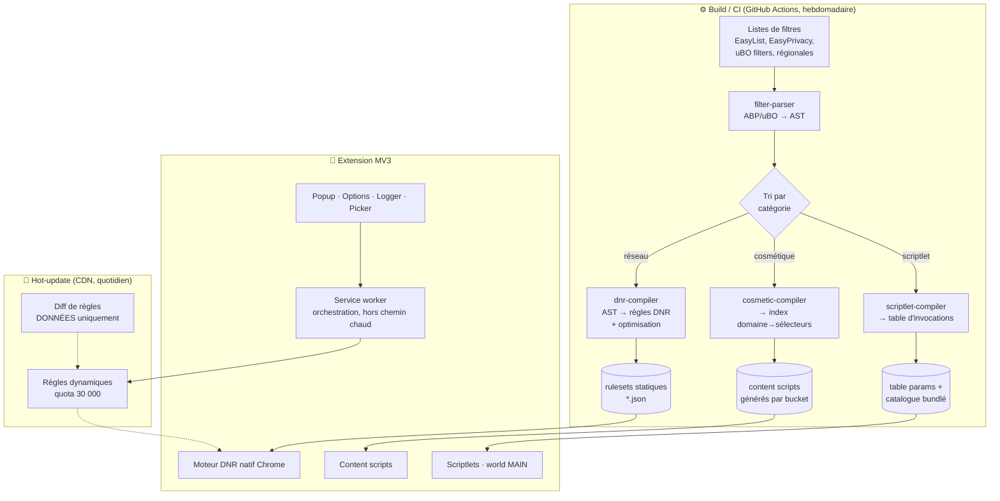

# Architecture proposée — AddBlocker

## Principe directeur

> **Le moteur de filtrage tourne au build, pas au runtime.**

En MV2, l'intelligence était dans l'extension. En MV3, l'extension n'est qu'un exécuteur de règles pré‑calculées. L'architecture doit donc mettre l'essentiel de la complexité dans une **chaîne de compilation** (`filtres texte → artefacts optimisés`) et garder le runtime aussi bête et rapide que possible.

Corollaire : la partie « produit » du projet, ce n'est pas l'extension. C'est le compilateur et sa CI.

## 1. Vue d'ensemble



## 2. Structure du dépôt

Monorepo TypeScript (pnpm workspaces) :

```
packages/
  filter-parser/       Parseur syntaxe ABP/uBO → AST typé. Zéro dépendance runtime.
  dnr-compiler/        AST réseau → règles DNR + rulesets. Le cœur du projet.
  cosmetic-compiler/   AST cosmétique → index + content scripts générés.
  scriptlet-runtime/   Catalogue de scriptlets (code bundlé, world MAIN).
  cosmetic-runtime/    Moteur de sélecteurs procéduraux + MutationObserver.
  extension/           L'extension MV3 elle-même (SW, content scripts, manifest).
  ui/                  Popup, page d'options, logger, element picker.
tools/
  build-rulesets/      Pipeline : fetch listes → compile → émet les artefacts.
  bench/               Harnais de mesure de parité (Playwright).
docs/
```

Découpage motivé : `filter-parser` et `dnr-compiler` sont testables sans navigateur et concentrent 80 % de la valeur. Ils doivent pouvoir évoluer sans toucher à l'extension.

## 3. Le compilateur DNR — cœur du système

### 3.1 Traduction des filtres

| Syntaxe uBO/ABP | Traduction DNR |
|---|---|
| `\|\|ads.com^` | `condition.urlFilter: "\|\|ads.com^"` (natif) |
| `\|\|ads.com^` (domaine entier) | **`condition.requestDomains: ["ads.com"]`** ← forme fusionnable, à privilégier |
| `$third-party` | `condition.domainType: "thirdParty"` |
| `$domain=a.com\|~b.com` | `initiatorDomains: ["a.com"]`, `excludedInitiatorDomains: ["b.com"]` |
| `$script,image` | `resourceTypes: ["script","image"]` |
| `@@\|\|x.com^` | `action.type: "allow"` + bande de priorité supérieure |
| `@@...$document` | `action.type: "allowAllRequests"` |
| `$important` | Bande de priorité supérieure |
| `$badfilter` | **Résolu à la compilation** — la règle visée est supprimée. Gratuit. |
| `$redirect=noopjs` | `action.type: "redirect"` → `web_accessible_resources` (règle *unsafe*) |
| `$removeparam=utm_*` | `redirect.transform.queryTransform.removeParams` (*unsafe*) |
| `$csp=...` | `modifyHeaders` append `Content-Security-Policy` (*unsafe*) |
| Regex `/.../` | `regexFilter` — **budget 1 000, à rationner** |

### 3.2 Modèle de priorité

DNR résout ainsi : priorité numérique la plus haute d'abord ; à priorité égale, `allow`/`allowAllRequests` > `block` > `redirect`/`upgradeScheme`. Il faut projeter le modèle de spécificité d'uBO sur ce seul entier. Échelle à bandes proposée :

| Classe de filtre | `priority` | Action |
|---|---|---|
| Blocage générique | `1000 + spécificité` | `block` |
| Exception `@@` | `2000 + spécificité` | `allow` |
| Blocage `$important` | `3000 + spécificité` | `block` |
| Exception `$important` | `4000 + spécificité` | `allow` |
| Exception de document (`$document`) | `5000` | `allowAllRequests` |
| `modifyHeaders` (`$csp`) | bande dédiée `900` | `modifyHeaders` |

où `spécificité` ∈ [0, 99] croît avec le nombre de contraintes (`$domain=` présent, `resourceTypes` restreint, longueur du motif). Ce mapping doit être **couvert par des tests de table** : c'est la source n°1 de divergences de comportement avec uBO.

### 3.3 Optimisations — comment tenir dans 30 000 règles

C'est ici que le projet se gagne ou se perd. ~100 000 filtres réseau doivent tenir dans le quota garanti.

1. **Fusion par domaines** (gain principal, ×10 à ×20). Les milliers de filtres « bloque ce domaine tiers » se fusionnent en une poignée de règles :
   ```jsonc
   // 3 000 filtres ||tracker1.com^, ||tracker2.com^, … deviennent :
   { "id": 1, "priority": 1000,
     "action": { "type": "block" },
     "condition": { "requestDomains": ["tracker1.com", "tracker2.com", /* … */],
                    "domainType": "thirdParty" } }
   ```
   `requestDomains` matche le domaine **et ses sous‑domaines** : sémantique identique à `||domain^`.
2. **Regroupement par signature** : clé = `(action, resourceTypes, domainType, initiatorDomains)`. Toutes les règles de même signature fusionnent leurs listes de domaines.
3. **Déduplication** et **élimination des règles couvertes** (`||ads.com^` rend `||ads.com/banner` inutile).
4. **Résolution statique de `$badfilter`** : suppression pure, aucun coût runtime.
5. **Budget regex** : convertir les regex simples en `urlFilter` ; ne garder en `regexFilter` que l'irréductible, avec un budget par ruleset et une erreur de build en cas de dépassement.
6. **Découpe en rulesets thématiques** (≤ 100 déclarés, ≤ 50 actifs) : `ads`, `privacy`, `annoyances`, `regional-fr`, `regional-de`… L'utilisateur active/désactive via `updateEnabledRulesets()`, ce qui libère du quota pour ceux qui n'en veulent pas.

**Garde‑fou CI obligatoire** : le build échoue si le total dépasse le budget, avec un rapport par ruleset. Sans ça, on découvre le problème à la publication.

### 3.4 Traçabilité

Le compilateur émet une **table de correspondance `règle DNR ↔ filtre source`** (`ruleId → texte du filtre + liste d'origine`). Indispensable pour le logger, pour le débogage utilisateur et pour les rapports « ce site est cassé ». C'est ce qu'AdGuard fait dans `tsurlfilter` et c'est ce qui manque cruellement quand on ne l'a pas prévu.

## 4. Moteur cosmétique

### 4.1 Le problème de latence

Un content script qui demande ses sélecteurs au service worker attend son réveil à froid (50–200 ms) → la pub s'affiche puis disparaît (flash). Inacceptable.

**Solution : pré‑génération au build.** Le compilateur émet des content scripts *statiques*, déclarés dans le manifest avec des `matches` ciblés. Chrome les injecte nativement à `document_start`, sans aucun aller‑retour ni réveil de service worker. Latence nulle.

```jsonc
// manifest.json — généré, pas écrit à la main
"content_scripts": [
  { "matches": ["*://*.youtube.com/*", "*://*.lemonde.fr/*", /* bucket 042 */],
    "js": ["/cosmetic/bucket-042.js"], "runAt": "document_start", "world": "ISOLATED" },
  { "matches": ["*://*.youtube.com/*"],
    "js": ["/scriptlets/bucket-042.js"], "runAt": "document_start", "world": "MAIN" }
]
```

Les domaines sont regroupés en **buckets** (~200 par bucket) pour éviter un manifest de plusieurs mégaoctets. Compromis : un site charge quelques sélecteurs inutiles de ses colocataires de bucket — coût négligeable face à la latence évitée.

### 4.2 Les trois niveaux

| Niveau | Contenu | Injection |
|---|---|---|
| **Spécifique** | `youtube.com##.ad-banner` | Content script statique du bucket, `document_start` |
| **Générique** | `##.advert` (tous sites) | Un script commun qui n'applique un sélecteur que si la classe/l'id existe réellement dans le DOM (approche uBO) |
| **Procédural** | `##.item:has-text(Sponsorisé)` | Moteur JS + MutationObserver, en monde ISOLATED |

Le CSS simple passe par une feuille `<style>` injectée en une fois (pas de manipulation DOM par élément) ; seul le procédural coûte du temps CPU, et uniquement sur les sites concernés.

### 4.3 Scriptlets

- Catalogue **bundlé dans le paquet** (contrainte CWS : c'est du code).
- Injection `world: "MAIN"`, `run_at: "document_start"`.
- **Paramètres externalisés** : le scriptlet `json-prune` est du code figé ; les chemins JSON qu'il élague sont des *données*, livrables à chaud. C'est le mécanisme qui permet de réagir aux ripostes YouTube sans republier (cf. analyse §6).

## 5. Mise à jour des filtres

Deux canaux, aux propriétés différentes :

| Canal | Support | Fréquence | Volume | Contrainte |
|---|---|---|---|---|
| **Statique** | Rulesets dans le paquet | Publication CWS hebdo | 30 000+ règles | Revue du store (heures→jours) |
| **Dynamique** | `updateDynamicRules()` | Quotidien, depuis CDN | 30 000 règles, dont 5 000 *unsafe* | Données uniquement, jamais de code |

Le service worker télécharge un **diff signé** (les règles récemment ajoutées aux listes amont), le valide contre un schéma strict, et l'applique en règles dynamiques. Les règles dynamiques ont une priorité de bande supérieure pour pouvoir corriger une règle statique défectueuse sans republier — c'est aussi le mécanisme de « kill switch » quand une règle casse un site.

**Validation stricte obligatoire** : un payload distant qui devient un `redirect` non contrôlé est une faille. Schéma en liste blanche : actions autorisées, cibles de redirection restreintes aux ressources locales de l'extension.

## 6. Runtime de l'extension

### Service worker
Éphémère par conception (Chrome le tue après ~30 s d'inactivité). Règle : **rien de critique sur le chemin chaud**. Il ne sert qu'à :
- orchestrer les mises à jour de listes (via `chrome.alarms`) ;
- appliquer les changements de réglages (`updateEnabledRulesets`, `updateDynamicRules`) ;
- enregistrer les content scripts dynamiques quand l'utilisateur passe un site en mode renforcé ;
- alimenter la popup.

Tout état est reconstructible depuis `chrome.storage`. Aucune variable globale supposée survivante.

### Modes par site
Trois niveaux, inspirés d'uBOL mais avec le niveau 2 par défaut :

| Mode | Réseau | Cosmétique | Scriptlets |
|---|---|---|---|
| Basique | DNR seul | — | — |
| **Standard** (défaut) | DNR | Spécifique | Oui |
| Complet | DNR | Spécifique + générique + procédural | Oui |

Le mode Complet requiert `host_permissions` sur le site, demandé à la volée (`chrome.permissions.request`) — ce qui évite de demander « accès à tous les sites » à l'installation, principal motif de désinstallation.

### Compteur de blocages — limitation à assumer
`getMatchedRules()` est plafonné à **20 appels / 10 min**, `onRuleMatchedDebug` n'existe qu'en extension non empaquetée. Le badge ne peut donc pas être exact. Stratégie retenue :
- appel `getMatchedRules()` au changement d'onglet actif uniquement (rationné) ;
- comptage exact côté content script pour les éléments cosmétiques masqués ;
- badge présenté comme un ordre de grandeur, pas comme un compteur exact.

Autant le décider maintenant : c'est une différence visible avec uBO et elle n'a pas de solution.

### Element picker & filtres utilisateur
- Picker : content script injecté à la demande, génère un filtre cosmétique → stocké localement, appliqué sans quota (c'est du CSS).
- Filtres réseau utilisateur → règles dynamiques (quota 30 000, largement suffisant).

## 7. Mesure de la parité — non négociable

« Aussi bon qu'uBO » doit être **mesuré**, sinon c'est une opinion. Harnais dans `tools/bench` :

- Corpus de 200–500 sites (top Tranco + sites connus pour leurs pubs agressives + sites FR).
- Chargement Playwright avec, en parallèle : (a) notre extension sur Chromium, (b) uBO MV2 sur Firefox comme référence.
- Métriques : requêtes tierces passées, nœuds publicitaires restants (heuristique de détection), CLS/temps de chargement, faux positifs (site cassé).
- Exécution en CI à chaque changement du compilateur → **détection de régression sur le taux de blocage**.

C'est ce harnais qui transforme le projet d'un « ad‑blocker de plus » en quelque chose de défendable.

## 8. Risques principaux

| Risque | Gravité | Mitigation |
|---|---|---|
| Dépassement du quota de règles | Élevée | Optimiseur + garde‑fou CI dès la phase 0 |
| Pool global 330 k épuisé par d'autres extensions | Moyenne | `getAvailableStaticRuleCount()` au démarrage, dégradation gracieuse par ruleset |
| Rejet à la revue CWS (code distant) | **Élevée** | Séparation code/données appliquée dès le premier commit |
| Divergence de priorité vs uBO (sites cassés) | Élevée | Tests de table sur le mapping + kill switch dynamique |
| Ripostes YouTube | Moyenne | Scriptlets paramétrables + canal de publication rapide |
| Cold start du service worker | Moyenne | Content scripts pré‑générés, SW hors chemin chaud |

## 9. Alternatives écartées

- **Fork d'uBOL** : base saine mais volontairement minimaliste (pas de cosmétique générique par défaut, pas de picker). Repartir de zéro sur le compilateur permet de viser plus haut ; on s'inspire en revanche fortement de sa technique de content scripts pré‑générés.
- **Réutiliser `@adguard/tsurlfilter`** : convertisseur DNR déjà mature et open source. **À évaluer sérieusement en phase 0** — si sa qualité de conversion est au rendez‑vous, cela économise l'essentiel de l'effort et concentre le travail sur le moteur cosmétique et l'UX. Décision à documenter en ADR après un banc d'essai comparatif.
- **Extension native + proxy local** : contourne MV3 mais exige une installation hors store. Hors périmètre.
